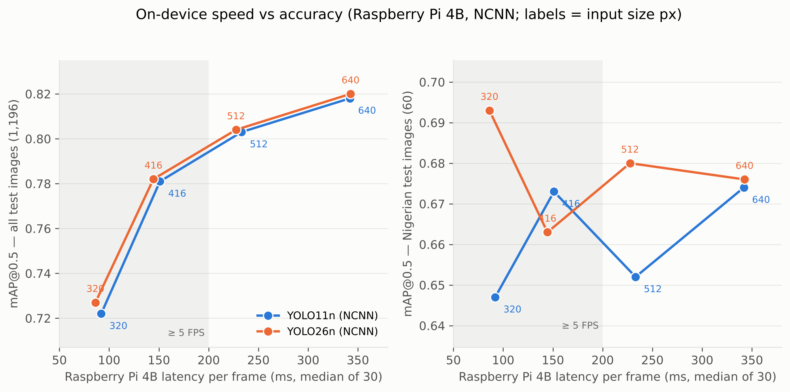

# 🌽 Maize & Weed Detection for an Autonomous Weeding Robot

[](https://maize-weed-detector-lcx64etcepujvmxuefcbnp.streamlit.app/)

**Live demo:** https://maize-weed-detector-lcx64etcepujvmxuefcbnp.streamlit.app/


A small robot car with a **Raspberry Pi 4** and a **Pi Camera** drives along maize rows, recognises
**maize** and **weeds** with a YOLO object detector, protects every maize plant, and fires a
(laser - LED stand-in for now) at weeds. This repository contains the full machine-learning pipeline:
dataset building, training and evaluation (Google Colab), the on-robot software, and a web dashboard.

<p align="center"></p>

## Highlights
| | |
|---|---|
| **Classes** | 0 = maize, 1 = weed (anything that is not maize) |
| **Dataset** | 7,308 field images from 5 public datasets (Nigeria, CornWeed, CropAndWeed, ACRE, Roboflow) - 35,367 maize and 304,031 weed boxes |
| **Models** | YOLO26n (chosen) and YOLO11n, trained with identical data and settings |
| **Accuracy (test, 1,196 images)** | YOLO26n: maize mAP@0.5 **0.937**, weed **0.705**, overall **0.821** |
| **Nigerian test images** | maize mAP@0.5 **0.897**, weed 0.470; **0% of maize plants classified as weed** |
| **Speed on Raspberry Pi 4** | YOLO26n NCNN 416 px: **~145 ms / frame (~7 FPS)** |
| **Robot safety logic** | two confidence thresholds (chosen on validation data), maize protection zones, a weed must be seen in 5 consecutive frames |

## Repository structure
```
├── app.py, detector.py, requirements.txt, .streamlit/   # Streamlit dashboard (deployed)
├── models/                    # exported NCNN models + robot_config.json (thresholds)
├── samples/                   # demo photos for the dashboard
├── notebooks/
│   ├── 01_build_dataset.ipynb        # downloads + converts 5 datasets, splits, report figures (CPU)
│   ├── 02_train_export.ipynb         # YOLO11n: train, evaluate, choose thresholds, export NCNN (GPU)
│   └── 02_train_export_yolo26.ipynb  # same pipeline for YOLO26n
├── raspberry_pi/              # code that runs on the robot (see raspberry_pi/README.md)
│   ├── weed_robot.py          # camera -> model -> filters -> maize protection -> LEDs (+ --drive)
│   ├── robot_drive.py         # route following with pause/resume (uses the motor driver in src/)
│   ├── src/test_motors.py     # L298N motor driver + config (by the hardware team)
│   ├── motors.py              # simpler backup motor script
│   ├── find_zone.py, live_view.py, bench_pi.py
└── results/                   # figures (PNG + PDF) and tables (CSV + LaTeX) for the report
    ├── model_comparison/      # YOLO11n vs YOLO26n
    └── pi_benchmark/          # on-device speed vs accuracy
```

## How to reproduce
1. **Dataset** - open `notebooks/01_build_dataset.ipynb` in Google Colab (CPU runtime), run all cells.
   It saves `maizeweed_dataset.zip` to Google Drive.
2. **Training** - open `notebooks/02_train_export_yolo26.ipynb` (GPU runtime, T4), run all cells
   (~3 h). It evaluates the model, selects the robot thresholds on the Nigerian validation images,
   exports NCNN models at 320/416/512/640 px and saves report figures/tables.
3. **Robot** - copy the exported `maize_weed_yolo26n_ncnn_416` folder to the Pi and follow
   [`raspberry_pi/README.md`](raspberry_pi/README.md).
4. **Dashboard** - `pip install -r requirements.txt` then `streamlit run app.py`
   (or use the live demo link above).

## Results
**Test set (1,196 images)**

| Model | maize mAP@0.5 | weed mAP@0.5 | all mAP@0.5 | all mAP@0.5:0.95 | Pi 4 latency (416 px) |
|---|---|---|---|---|---|
| YOLO11n | 0.935 | 0.703 | 0.819 | 0.490 | 151 ms |
| **YOLO26n** | **0.937** | **0.705** | **0.821** | 0.489 | **145 ms** |

**Raspberry Pi 4 speed (NCNN, median of 30 frames)**

| Input size | YOLO11n | YOLO26n |
|---|---|---|
| 320 px | 92 ms (10.9 FPS) | 86 ms (11.6 FPS) |
| 416 px | 151 ms (6.6 FPS) | 145 ms (6.9 FPS) |
| 512 px | 233 ms (4.3 FPS) | 228 ms (4.4 FPS) |
| 640 px | 342 ms (2.9 FPS) | 343 ms (2.9 FPS) |

More figures and tables: [`results/`](results/).

## Datasets and licences
- Maize-Weed Image dataset, Niger State, Nigeria (Olaniyi et al., 2023, *Data in Brief*) - CC BY 4.0
- CornWeed (DFKI, Zenodo 7961764)
- CropAndWeed (Steininger et al., WACV 2023) - **non-commercial research use only**
- ACRE Crop-Weed (Zenodo 8102217) - CC BY 4.0
- Roboflow "corn-weed" (emad-yousry) - CC BY 4.0

Models are trained with [Ultralytics YOLO](https://github.com/ultralytics/ultralytics) (AGPL-3.0).
Because of the CropAndWeed licence, the trained models are for research/education use.

## Team
- Machine learning & vision: *your name*
- Robot hardware & motor control: *teammate's name*
